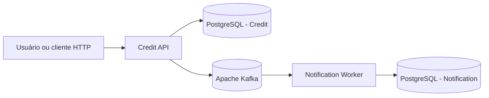

# Arquitetura do Credite

## Visão geral

O Credite terá somente dois microsserviços:

1. **Credit API:** recebe e gerencia clientes fictícios e solicitações de crédito.
2. **Notification Worker:** recebe eventos publicados pelo Credit e registra notificações.

A comunicação entre os serviços será assíncrona por Apache Kafka.

## Diagrama

## Responsabilidades

### Credit API

- Cadastrar e consultar clientes fictícios.
- Criar e consultar solicitações de crédito.
- Aplicar regras demonstrativas simples.
- Publicar eventos quando uma solicitação for registrada ou mudar de estado.
- Ser a única responsável pelos dados de clientes e solicitações.

### Notification Worker

- Consumir eventos publicados pelo Credit.
- Processar cada evento e registrar uma notificação fictícia.
- Ser o único responsável pelos registros de notificação.
- Não consultar o banco do Credit.

## Comunicação e persistência

- O Credit expõe HTTP para os clientes da API.
- O Credit publica eventos no Kafka.
- O Notification consome eventos do Kafka.
- Cada serviço possui seu próprio banco PostgreSQL.
- No ambiente local, os dois bancos podem rodar na mesma instância PostgreSQL.
- Não compartilhar tabelas, migrations, DbContexts ou transações entre serviços.

A primeira versão da integração poderá publicar o evento após salvar a solicitação. O risco de falha entre a gravação e a publicação será estudado e corrigido posteriormente com Transactional Outbox.

## Decisões de simplicidade

- Um projeto executável por microsserviço.
- Sem projetos separados de Domain, Application e Infrastructure no início.
- Sem autenticação ou autorização no MVP.
- Sem interface Web.
- Sem API Gateway.
- Sem Redis ou MongoDB.
- Sem chamadas HTTP entre os microsserviços.
- Sem abstrações ou bibliotecas extras antes de existir necessidade.

## Evolução

A simplicidade inicial não significa ignorar boas práticas. Testes, validação, tratamento de erros, idempotência, Outbox, retry e dead-letter serão introduzidos em etapas, para que cada conceito seja aprendido quando o fluxo básico já estiver funcionando.

## Limites do produto

Todos os dados são fictícios. O projeto não calcula score financeiro real, não aprova crédito de verdade e não integra instituições financeiras.
