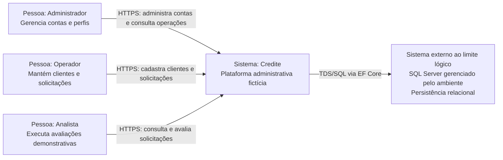
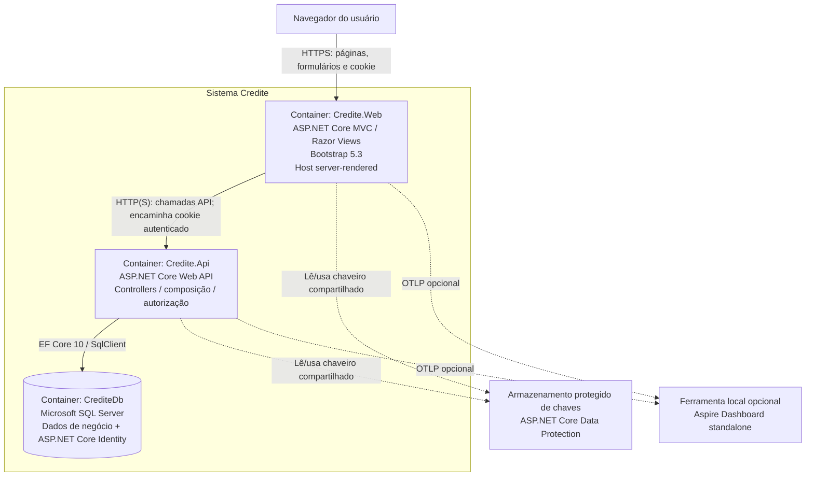
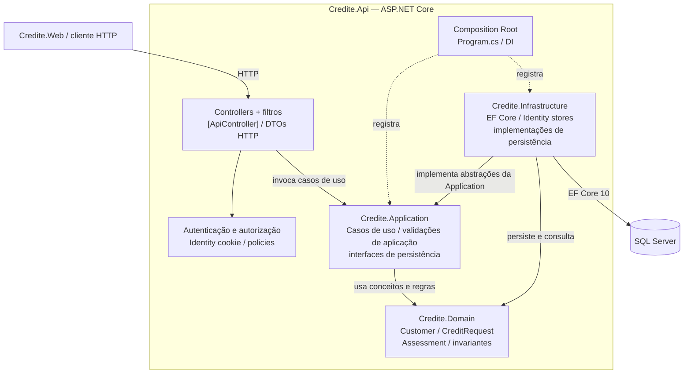
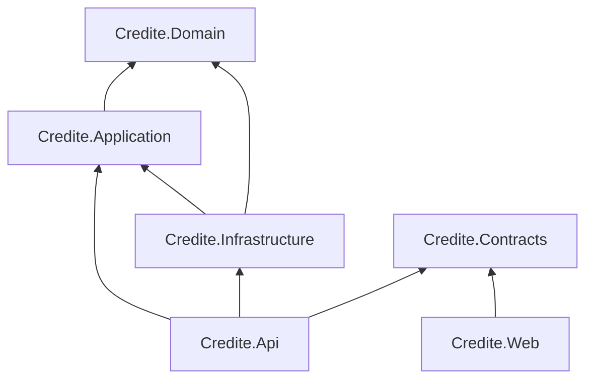
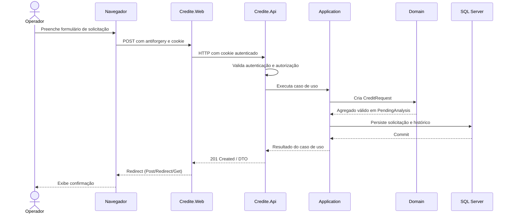

# Arquitetura do Credite

- **Estado:** Especificação consolidada
- **Atualização:** 2026-11-07
- **Decisões normativas:** ADR-0001 a ADR-0013
- **Escopo:** arquitetura lógica e runtime do MVP; não representa infraestrutura implantada nem comprova que todos os projetos já existem/compilam.

Este documento reúne a visão arquitetural aprovada e os diagramas de referência. Quando houver divergência, os ADRs específicos prevalecem para a decisão detalhada. Os diagramas devem ser atualizados junto com mudanças de arquitetura.

## 1. Resumo executivo

O Credite é uma aplicação administrativa educacional para gestão de clientes e solicitações de crédito fictícias. O MVP utiliza um **monólito modular**, com dois hosts ASP.NET Core: uma interface MVC server-rendered e uma API REST. Os módulos de negócio são executados dentro do processo da API; SQL Server é a persistência relacional; Identity administra contas internas.

A interface MVC comunica-se exclusivamente com a API por HTTP. Não possui DbContext nem acesso direto ao banco. A API autentica e autoriza cada operação protegida, mesmo quando a chamada se origina do MVC. A solução não contém microserviços, broker, API Gateway ou cache distribuído no MVP.

## 2. Diagrama C4 — Nível 1: contexto do sistema

Mostra os atores e os sistemas externos ao Credite. Os atores são usuários internos; clientes fictícios são registros de negócio e não acessam o sistema.

**Leitura:** os três perfis usam a mesma aplicação, com capacidades diferentes. O banco é uma dependência técnica do sistema, não um sistema de negócio independente. Não existem integrações com bancos, birôs de crédito, meios de pagamento ou serviços financeiros externos.

## 3. Diagrama C4 — Nível 2: containers

Neste projeto, container significa aplicação executável ou armazenamento de dados, não necessariamente Docker.

### Containers e responsabilidades

| Container | Responsabilidade | Tecnologia | Persistência/acesso |
|---|---|---|---|
| Credite.Web | Interface administrativa, autenticação de navegação, ViewModels e chamadas HTTP | ASP.NET Core MVC, Razor Views, Bootstrap 5.3 | Sem acesso ao SQL Server |
| Credite.Api | Contratos REST, autenticação/autorização de backend, execução de casos de uso e composição | ASP.NET Core Web API | Acesso a SQL Server por Infrastructure |
| CrediteDb | Persistência de clientes, solicitações, avaliações, histórico e Identity | SQL Server + EF Core 10 | Único banco do MVP |
| Aspire Dashboard | Visualização local opcional de logs, métricas e traces | Aspire Dashboard standalone / OTLP | Não é dependência de runtime; sem retenção de produção |

O armazenamento das chaves Data Protection precisa ser compartilhado e protegido nos dois hosts, com configuração consistente de esquema, nome de cookie e nome da aplicação. O mecanismo concreto de armazenamento varia por ambiente: desenvolvimento local pode usar diretório protegido compartilhado; outros ambientes devem usar armazenamento persistente e protegido apropriado. Não versionar chaves.

O diagrama mostra a arquitetura lógica, não fixa portas, nomes de contêiner Docker, hostnames ou topologia de implantação. Esses detalhes pertencem à configuração do ambiente, não a esta arquitetura.

## 4. Diagrama C4 — Nível 3: componentes do container API

**Dependências de compilação entre projetos** (seta significa “referencia”):

Regras obrigatórias:

- Domain não referencia nenhum projeto da solução ou framework de infraestrutura.
- Application referencia Domain e define abstrações necessárias aos casos de uso.
- Infrastructure referencia Application e Domain e implementa persistência/serviços técnicos.
- API referencia Application, Infrastructure e Contracts; Infrastructure é utilizada na raiz de composição, não diretamente por Controllers.
- Web referencia Contracts entre os projetos internos e não referencia Domain, Application ou Infrastructure.
- Contracts contém DTOs HTTP explícitos; não contém entidades de domínio, regras de negócio, ViewModels ou tipos do EF Core.
- Testes unitários exercitam Domain/Application sem infraestrutura externa; testes de integração exercitam API, Identity e SQL Server conforme ADR-0003.

A seta de Infrastructure para Application no diagrama de componentes indica implementação de abstrações definidas pela Application (dependência de compilação). O fluxo de execução de um caso de uso chama a abstração; a implementação concreta é resolvida por injeção de dependência na raiz de composição da API.

## 5. Componentes do container Web

A aplicação MVC é um cliente HTTP server-rendered:

- **MVC Controllers:** recebem requisições de páginas, aplicam políticas de interface e coordenam serviços de apresentação.
- **ViewModels:** modelos próprios de telas e formulários; nunca entidades de domínio ou entidades EF Core.
- **Razor Views:** renderizam HTML, formulários e estados de página.
- **API clients/services:** encapsulam chamadas HTTP tipadas/nomeadas, serialização, timeout e tradução de Problem Details.
- **Authentication/Data Protection:** valida o cookie compartilhado e encaminha a identidade autenticada à API no request HTTP conforme ADR-0002.
- **Antiforgery:** protege formulários MVC que alteram estado.

A Web não implementa regras de negócio, não consulta SQL Server e não contorna a API. A ocultação de itens de navegação por perfil melhora a experiência, mas a API continua sendo a autoridade final de autorização.

## 6. Módulos de negócio

Os módulos são limites lógicos dentro do monólito, não processos ou projetos independentes.

| Módulo | Responsabilidade no MVP | Conceitos principais |
|---|---|---|
| Customer | Cadastro, consulta e manutenção de clientes fictícios | Customer |
| Credit | Solicitações, estados, avaliações demonstrativas e histórico | CreditRequest, Assessment, CreditRequestHistoryEntry |
| Identity / Access | Contas internas, perfis e autorização | ASP.NET Core Identity, roles e policies |

A simulação Price é uma capacidade interna do módulo Credit no MVP. Risk Analysis não é um serviço autônomo. Notification ainda não é um contexto funcional aprovado. A extração futura depende dos critérios do ADR-0012.

## 7. Diagrama dinâmico — fluxo vertical principal

Fluxo de referência para criar uma solicitação e registrar uma avaliação. Os detalhes dos campos e validações seguem os requisitos do MVP e os ADRs de domínio/simulação.

A execução da simulação segue a mesma fronteira: o Analista envia um comando; a API autoriza; Application solicita a operação de domínio; a avaliação demonstrativa é registrada como snapshot imutável junto do histórico, preservando avaliações anteriores conforme ADR-0008 e ADR-0009. O sistema não produz decisão financeira real.

## 8. Persistência e transações

- SQL Server é o banco relacional aprovado (ADR-0001).
- EF Core 10 usa Code First; DbContext, configurações e migrations ficam em Infrastructure.
- Migrations e snapshots são versionados.
- A aplicação de migrations é explícita; API não executa migrations automaticamente na inicialização.
- Customer e CreditRequest são agregados independentes; CreditRequest referencia Customer por CustomerId.
- No MVP, os módulos compartilham SQL Server e podem utilizar transações locais quando um caso de uso exigir atomicidade.
- Avaliações anteriores e entradas de histórico não podem ser sobrescritas silenciosamente.
- Não há banco por módulo, CQRS distribuído, event sourcing ou Outbox no MVP.

## 9. Segurança e confiança

- ASP.NET Core Identity administra contas internas; não há registro público de contas.
- Roles iniciais: Administrador, Analista e Operador.
- Autorização de negócio é aplicada pela API; MVC não é fronteira de segurança suficiente.
- Cookies compartilhados e Data Protection seguem ADR-0002; HTTPS, Secure, HttpOnly, SameSite e antiforgery conforme o fluxo.
- Segredos locais via User Secrets; demais ambientes via variáveis de ambiente ou secret manager.
- Somente dados e credenciais fictícios/demonstrativos. Nunca registrar ou persistir dados reais de pessoas ou dados financeiros reais.
- Health endpoints, logs e telemetria não devem expor segredos nem detalhes internos a clientes não autorizados.
- OWASP ASVS 5.0.0 nível 1 é checklist de referência aplicável, sem declaração de certificação/conformidade.

## 10. Observabilidade e saúde

- `ILogger<T>` para logs estruturados; sem senhas, cookies, tokens, connection strings ou conteúdo sensível.
- OpenTelemetry para logs, métricas e traces, com OTLP opcional.
- Propagação W3C Trace Context em chamadas Web → API e dependências instrumentadas.
- Aspire Dashboard standalone é opcional para visualização local, não plataforma de produção.
- API: `/health/live` (processo) e `/health/ready` (dependências necessárias, incluindo SQL Server); `/health` permanece alias compatível da readiness.
- Web: `/health/live`; sem acesso direto ao banco.
- Detalhamento normativo: ADR-0011.

## 11. Testes e qualidade

- Unitários: Domain e Application, sem SQL Server nem serviços externos.
- Integração: API/HTTP, Identity, autorização, EF Core, migrations e SQL Server real descartável, preferencialmente via Testcontainers.
- Web: testar integração com API e tratamento de respostas/erros; validar antiforgery e jornadas principais.
- Não substituir SQL Server por EF Core InMemory ou SQLite nos testes de persistência.
- CI executa restore, build, testes unitários e de integração; integração exige Docker e banco descartável.
- WCAG 2.2 AA é objetivo para jornadas principais da interface; requer revisão manual além de ferramentas automáticas.

## 12. Implantação e execução local

A topologia inicial é composta por dois hosts .NET e SQL Server. Durante desenvolvimento, os hosts podem ser iniciados pelo Visual Studio Community; SQL Server pode ser local ou em contêiner conforme a configuração de desenvolvimento/teste. Docker Compose é auxiliar para dependências, não requisito para a arquitetura lógica.

Não está definido um ambiente de produção, domínio, provedor cloud, orquestrador, política de escalabilidade, alta disponibilidade ou SLA. Não inferir esses itens a partir dos diagramas. A implantação futura precisa especificar armazenamento persistente de Data Protection, TLS, segredos, banco, backup/restore, health probes e destino de telemetria.

## 13. Decisões relacionadas

- ADR-0001 — SQL Server e persistência.
- ADR-0002 — Autenticação, autorização e dados fictícios.
- ADR-0003 — Estratégia de testes.
- ADR-0004 — Contratos REST, erros e convenções HTTP.
- ADR-0005 — Arquitetura inicial e limites entre camadas.
- ADR-0006 — Requisitos não funcionais e qualidade.
- ADR-0007 — Visão do produto, atores e limites.
- ADR-0008 — Modelagem do domínio e ciclo de vida.
- ADR-0009 — Simulação demonstrativa e avaliação.
- ADR-0010 — Interface administrativa MVC.
- ADR-0011 — Observabilidade e operação local.
- ADR-0012 — Evolução para microserviços e mensageria.
- ADR-0013 — Laboratórios de PostgreSQL, MongoDB e Apache Kafka.

## 14. Trilha educacional Back-End — fora do MVP

A evolução profissional do responsável inclui aprofundar C#/.NET, APIs REST, arquitetura, SQL, PostgreSQL, MongoDB, Apache Kafka e microsserviços. Essa trilha não muda automaticamente as decisões do produto.

- **Stack praticada no Credite:** C# 14, .NET 10, ASP.NET Core, APIs REST, EF Core 10, SQL Server, Identity, xUnit e testes de integração.
- **PostgreSQL:** laboratório relacional comparativo com SQL Server; não substitui o banco do MVP.
- **MongoDB:** laboratório de modelagem documental; não será adicionado como persistência paralela sem caso de uso.
- **Apache Kafka:** laboratório isolado de producers, consumers, topics, partitions, consumer groups, idempotência, retry e dead-letter topic. Não integrar ao fluxo principal do MVP.
- **Microsserviços:** exercício posterior de extração de um contexto estável, com ownership de dados, contratos, falhas parciais, consistência eventual e observabilidade.

O critério para considerar cada assunto dominado é conseguir explicar, implementar, testar, diagnosticar falhas e justificar trade-offs. Diferenciar sempre tecnologia utilizada no produto, praticada em laboratório e apenas estudada.

## 15. Referências

- [C4 Model — Diagrams](https://c4model.com/diagrams)
- [C4 Model — Notation](https://c4model.com/diagrams/notation)
- [Microsoft — Common web application architectures and Clean Architecture](https://learn.microsoft.com/dotnet/architecture/modern-web-apps-azure/common-web-application-architectures)
- [GitHub Docs — Creating diagrams with Mermaid](https://docs.github.com/en/get-started/writing-on-github/working-with-advanced-formatting/creating-diagrams)
- [Microsoft — Share authentication cookies between ASP.NET Core apps](https://learn.microsoft.com/aspnet/core/security/cookie-sharing)
- ADR-0001 a ADR-0012.
